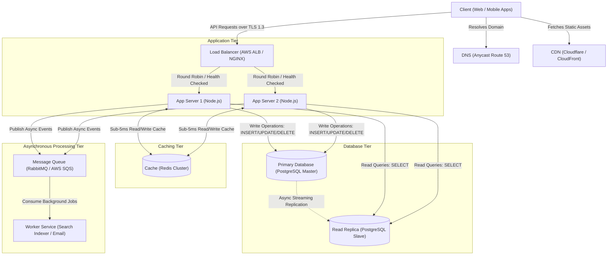

# QuickNotes System Architecture Specification

**Scale Target:** 1,000,000 Registered Users  
**System Type:** Distributed High-Availability Note-Taking Platform  
**Document Status:** Production Design Baseline

---

## 1. System Requirements

### 1.1 Functional Requirements
1. **User Authentication & Authorization**: Users can securely register, log in via JWT credentials, and manage their profiles with strict multi-tenant isolation.
2. **Note Management (CRUD)**: Users can create, read, update, and delete notes containing titles (up to 100 characters) and optional formatted body content.
3. **Categorization & Tagging**: Users can create custom tags and organize notes through a flexible many-to-many relationship.
4. **Search & Filtering**: Users can filter notes by tags, search titles and bodies by keywords, and view notes ordered chronologically.
5. **Pagination**: Note lists support cursor and limit-offset pagination to keep payload sizes small.

### 1.2 Non-Functional Requirements
1. **High Availability**: Target **99.99% uptime** (< 52.6 minutes of unplanned downtime per year) through redundant multi-zone deployments.
2. **Low Latency**:
   - Read requests (`GET /notes`): p95 < **50ms**.
   - Write requests (`POST /notes`): p95 < **150ms**.
3. **Scalability**: Designed to gracefully support **1,000,000 registered users** and 200,000 daily active users with automatic horizontal scaling.
4. **Data Durability & Consistency**: Zero data loss for committed notes (Recovery Point Objective RPO = 0; Recovery Time Objective RTO < 5 minutes) using ACID transactional persistence and automated backups.
5. **Security & Compliance**: End-to-end TLS 1.3 encryption in transit, AES-256 encryption at rest, parameterized queries preventing SQL injection, and rate limiting (100 req/min/user).

---

## 2. Load & Capacity Estimates (1 Million Users)

### 2.1 User Base & Concurrency
- **Total Registered Users**: 1,000,000
- **Daily Active Users (DAU)**: 20% = **200,000 users/day**
- **Peak Hour Traffic**: 40% of daily requests occur during peak 4 hours of the day.

### 2.2 Throughput Calculations (Reads & Writes)
- **Read Operations**:
  - Average reads per active user: **10 reads/day** (opening dashboard, searching, viewing notes).
  - Total daily reads = $200,000 \times 10 = 2,000,000\text{ reads/day}$.
  - **Average Read Throughput** = $\frac{2,000,000}{86,400\text{ s}} \approx \mathbf{23.15\text{ reads/sec}}$.
  - **Peak Read Throughput** (using peak factor of 3x) $\approx \mathbf{70\text{ reads/sec}}$ (with burst spikes up to **120 reads/sec**).

- **Write Operations**:
  - Average writes per active user: **2 writes/day** (creating, editing, or deleting notes).
  - Total daily writes = $200,000 \times 2 = 400,000\text{ writes/day}$.
  - **Average Write Throughput** = $\frac{400,000}{86,400\text{ s}} \approx \mathbf{4.63\text{ writes/sec}}$.
  - **Peak Write Throughput** (using peak factor of 3x) $\approx \mathbf{14\text{ writes/sec}}$ (with burst spikes up to **25 writes/sec**).

- **Read-to-Write Ratio**: Approximately **5 : 1** (moderately read-heavy workload).

### 2.3 Storage Capacity Calculations
- **Average Note Footprint**:
  - Title: ~50 bytes
  - Body: ~1,000 bytes (1 KB average text)
  - Metadata (IDs, foreign keys, timestamps, booleans): ~150 bytes
  - **Total raw payload per note** $\approx \mathbf{1.2\text{ KB}}$.
- **Daily Data Ingestion**:
  - $400,000\text{ writes/day} \times 1.2\text{ KB} \approx \mathbf{480\text{ MB/day}}$.
- **Annual Storage Consumption**:
  - Raw table data: $480\text{ MB/day} \times 365\text{ days} \approx \mathbf{175.2\text{ GB/year}}$.
  - B-Tree Indexes & Database Overhead (+30%): $\approx \mathbf{52.5\text{ GB/year}}$.
  - **Total Storage Required Per Year** $\approx \mathbf{227.7\text{ GB/year}}$.
  - 5-Year Storage Capacity Plan $\approx \mathbf{1.14\text{ TB}}$.

### 2.4 In-Memory Cache Sizing (Redis)
- Following the Pareto principle (80/20 rule), 20% of users' notes generate 80% of daily read volume.
- Working set for 200,000 active users caching their 10 most recent notes:
  - $200,000 \times 10\text{ notes} \times 1.2\text{ KB} \approx \mathbf{2.4\text{ GB}}$.
- Factoring in Redis metadata overhead, session tokens, and connection buffers:
  - A **16 GB Redis Cluster** comfortably holds the entire active working set in RAM with a cache hit ratio $> 90\%$.

---

## 3. System Architecture Diagram

```
                              +--------------------+
                              |  Client Devices    |
                              |  (Web / Mobile)    |
                              +--------------------+
                                        |
                                        v
                              +--------------------+
                              |  DNS (Route 53)    |
                              +--------------------+
                                        |
                 +----------------------+----------------------+
                 |                                             |
                 v (Static Assets)                             v (Dynamic API Requests)
      +--------------------+                         +--------------------+
      |  CDN (Cloudflare)  |                         |   Load Balancer    |
      |  Static HTML/CSS/JS|                         |   (AWS ALB/NGINX)  |
      +--------------------+                         +--------------------+
                                                               |
                                        +----------------------+----------------------+
                                        |                                             |
                                        v                                             v
                             +--------------------+                        +--------------------+
                             |   App Server 1     |                        |   App Server 2     |
                             |   (Node.js / Go)   |                        |   (Node.js / Go)   |
                             +--------------------+                        +--------------------+
                                    |         \                                /         |
                  +-----------------+          +------------------------------+          +-----------------+
                  |                                           |                                            |
                  v                                           v                                            v
        +--------------------+                      +--------------------+                       +--------------------+
        |   Cache (Redis)    |                      |  Primary Database  |                       |   Message Queue    |
        |   Hot Notes & Auth |                      | (PostgreSQL Master)|                       | (RabbitMQ / SQS)   |
        +--------------------+                      +--------------------+                       +--------------------+
                                                              |                                            |
                                              Streaming Sync  |                                            | Async Jobs
                                                              v                                            v
                                                    +--------------------+                       +--------------------+
                                                    |   Read Replica     |                       |   Worker Service   |
                                                    | (PostgreSQL Slave) |                       | (Search / Analytics|
                                                    +--------------------+                       +--------------------+
```

### Mermaid Architecture Diagram


---

## 4. Component Explanations

Each component in the architecture solves a specific scalability or reliability challenge:

1. **Client**: Provides the responsive, secure user interface in the browser or mobile device to execute CRUD note actions and display real-time feedback.
2. **DNS (Domain Name System)**: Translates domain names into IP addresses and routes clients to the geographically closest and healthiest infrastructure endpoints.
3. **CDN (Content Delivery Network)**: Caches and serves static assets (`index.html`, `style.css`, `api.js`, images) at edge locations close to users, reducing page latency and offloading static traffic from origin servers.
4. **Load Balancer**: Distributes incoming HTTP/HTTPS traffic across multiple application servers, terminates TLS encryption, and routes traffic away from unhealthy instances.
5. **App Servers (App Server 1 & App Server 2)**: Execute stateless business logic, validate inputs, enforce authentication/authorization, and orchestrate queries across database, cache, and queue components.
6. **Cache (Redis Cluster)**: Stores frequently read note lists and user sessions in memory, eliminating repetitive database queries and ensuring sub-5ms read responses.
7. **Primary Database (PostgreSQL Master)**: Serves as the authoritative source of truth for all write operations, enforcing ACID transaction guarantees and relational schema constraints.
8. **Read Replica (PostgreSQL Slave)**: Offloads read queries from the primary database via asynchronous streaming replication, enabling horizontal read scalability.
9. **Queue (RabbitMQ / SQS)**: Buffers non-critical background jobs (such as search indexing, email alerts, and audit logging) so that HTTP requests complete without waiting for heavy background processing.
10. **Worker**: Consumes tasks from the message queue in the background and executes intensive operations (e.g. updating search indexes) asynchronously without blocking API threads.

---

## 5. Step-by-Step Request Flows

### 5.1 `GET /notes` Flow (Read Operation with Cache-Aside Pattern)
1. **User Action**: The client issues an authenticated request: `GET /api/v1/notes?page=1` with `Authorization: Bearer <jwt>`.
2. **Routing & SSL Termination**: DNS directs the request to the Load Balancer, which validates the TLS certificate and forwards the HTTP request to an available App Server.
3. **Authentication**: The App Server verifies the JWT signature and extracts the caller's `user_id`.
4. **Cache Lookup**: The App Server queries the Redis Cache for the key `user:{user_id}:notes:page:1`.
5. **Cache Hit Path**: If key exists in Redis, the App Server serializes the cached JSON and returns `200 OK` to the client in under 10ms.
6. **Cache Miss Path**:
   - The App Server sends a SQL query (`SELECT ... FROM notes WHERE user_id = $1 ...`) to the **Read Replica**.
   - The Read Replica uses index `idx_notes_user_updated` to fetch rows in < 5ms.
   - The App Server populates Redis with the query result and sets a 15-minute Time-To-Live (TTL).
7. **Response**: The App Server formats the standard response JSON envelope and returns `200 OK` to the client.

---

### 5.2 `POST /notes` Flow (Write Operation with Cache Invalidation & Event Queuing)
1. **Submission**: The user submits the note form, sending `POST /api/v1/notes` with body `{ "title": "...", "body": "...", "tag_ids": [...] }`.
2. **Load Balancing**: The Load Balancer inspects instance health and forwards the request to an App Server.
3. **Validation**: The App Server validates that `title` is non-empty and $\le 100$ characters.
4. **Transactional Write**: The App Server opens an ACID database transaction on the **Primary Database**:
   - Inserts record into `notes` table and obtains generated `id`.
   - Inserts junction records into `note_tags` for each provided tag ID.
   - Commits transaction.
5. **Replication**: The Primary Database streams write-ahead log (WAL) entries asynchronously to the **Read Replica**.
6. **Cache Invalidation**: The App Server deletes existing cached note lists for this user in Redis (`DEL user:{user_id}:notes:*`) to prevent stale reads on subsequent requests.
7. **Asynchronous Enqueueing**: The App Server publishes an event `{ "event": "note.created", "note_id": 10482, "user_id": 901 }` to the **Message Queue**.
8. **Client Response**: The App Server immediately returns `201 Created` with the new note payload and ID to the user.
9. **Background Processing**: The **Worker Service** consumes the event from the queue to update the full-text search index and record user activity metrics.

---

## 6. Architectural Trade-offs

### Trade-off 1: Relational SQL (PostgreSQL) vs. Document NoSQL (MongoDB / DynamoDB)
- **Decision**: Selected PostgreSQL with normalized tables and read replicas.
- **Pros**: Guarantees ACID transactional consistency, ensures zero orphan records via `ON DELETE CASCADE`, avoids tag data duplication, and easily handles 1M users (~100 GB dataset) on standard hardware.
- **Cons**: Requires active database schema migrations and vertical scaling for writes, whereas NoSQL offers easier automatic horizontal sharding out of the box.
- **Justification**: QuickNotes' core domain is inherently relational (many-to-many tag mappings). In a NoSQL document database, renaming a tag would require updating thousands of embedded documents, introducing severe write amplification and consistency anomalies.

### Trade-off 2: Cache-Aside vs. Write-Through Caching
- **Decision**: Implemented the **Cache-Aside (Lazy Loading)** pattern with proactive cache invalidation on writes.
- **Pros**: Only actively requested data is stored in Redis, keeping memory utilization minimal. Cache failures do not prevent writes or cause request timeouts; if Redis fails, the system falls back directly to the database.
- **Cons**: Cache misses incur a slight latency penalty (database read + cache write), and there is a potential risk of transient stale reads if invalidation fails.
- **Justification**: Note taking is bursty—most notes created are rarely re-read. Caching every write via write-through would waste expensive in-memory RAM on dormant notes.

### Trade-off 3: Asynchronous Replication (Read Replicas) vs. Synchronous Replication
- **Decision**: Asynchronous streaming replication from Primary to Read Replicas.
- **Pros**: Writes on the primary complete with zero network delay, maximizing write throughput and preventing replica slowdowns from degrading user experience.
- **Cons**: Introduces small replication lag (typically 10–50ms). If a user creates a note and immediately queries the read replica before WAL catch-up, the new note might not appear on a cache miss.
- **Mitigation**: The client prepends the newly created note into DOM/state locally upon 201 Created response. Additionally, the App Server can enforce "read-your-own-writes" by routing reads to the Primary for 2 seconds following any write operation by that user.

---

## 7. Single Points of Failure (SPOF) Mitigation

To guarantee 99.99% availability, every layer of the architecture is designed with redundancy, health checks, and automatic failover:

| Tier | Potential Failure | Redundancy & Automated Recovery Strategy |
| :--- | :--- | :--- |
| **DNS** | DNS server outage | Deployed on AWS Route 53 with 100% SLA, Anycast global routing, and health-checked endpoint failover. |
| **CDN** | Edge node network partition | Cloudflare globally distributed Anycast network automatically reroutes edge requests away from degraded data centers. |
| **Load Balancer** | Load balancer hardware/AZ crash | AWS Application Load Balancer operates active-active across multiple Availability Zones (AZs) with automated IP failover. |
| **App Servers** | App server crash or memory leak | Stateless instances placed in an Auto-Scaling Group across $\ge 2$ Availability Zones. Health checks remove failed instances and spawn healthy replacements in under 60 seconds. |
| **Cache (Redis)** | Redis node failure | Redis Sentinel / AWS ElastiCache deployed with Multi-AZ replication and automated primary failover (< 15 seconds). App code gracefully falls back to database if cache is unreachable. |
| **Primary DB** | Master database host failure | Multi-AZ deployment (e.g. AWS RDS Multi-AZ). If the Primary fails, an automated synchronous standby in another AZ is promoted to Primary within 30–60 seconds via automated DNS switch. |
| **Read Replica** | Read replica crashes | Multiple read replicas configured across zones. The connection pool automatically reroutes read queries to surviving replicas or the Primary DB. |
| **Message Queue** | Queue broker crash | RabbitMQ deployed in a clustered mirrored-queue configuration (or AWS SQS with multi-AZ native durability), ensuring zero message loss if a node fails. |
| **Worker Tier** | Worker process dies | Workers are managed by process supervisors (Kubernetes deployment or systemd) that automatically restart crashed pods or scale worker count based on queue backlog depth. |
